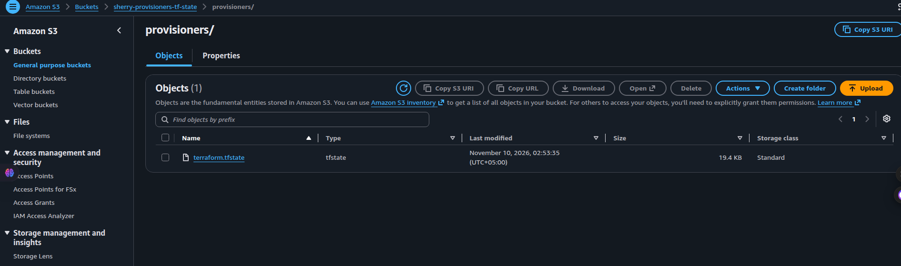
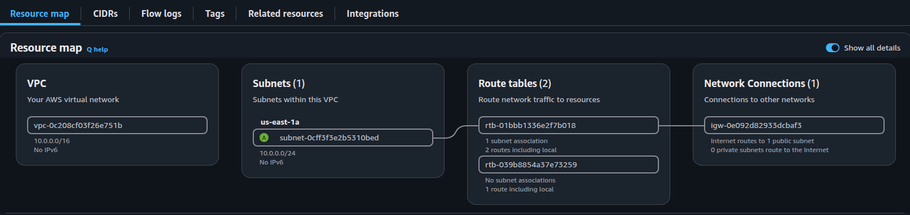
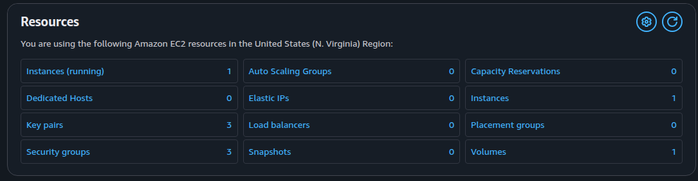
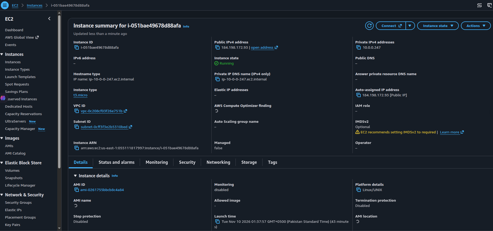
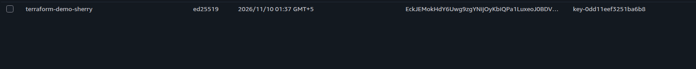
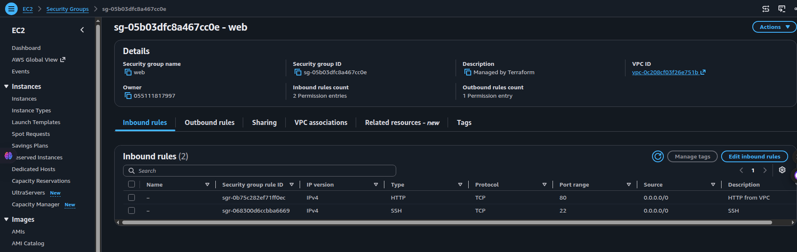
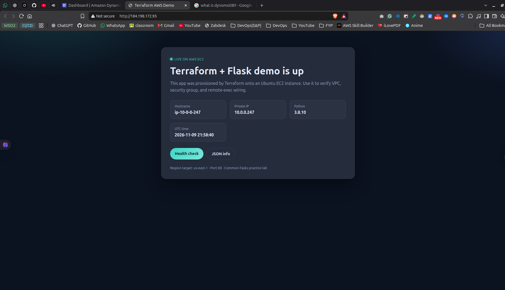

<div align="center">

# Practice 03 — Provisioners

**VPC · EC2 · file + remote-exec · S3 remote state**

Part of [`Terraform-AWS-Prac`](../README.md)

[](#)
[](#)
[](#)

</div>

---

## Purpose

This lab builds a small public web stack with Terraform, then uses **provisioners** to configure the instance after it boots.

You will practice:

- Creating a VPC, subnet, IGW, routes, security group, key pair, and EC2
- Copying `app.py` with a **file** provisioner
- Installing Flask and starting the app with **remote-exec**
- Bootstrapping an S3 bucket, then migrating state with `use_lockfile`

> Sandbox lab. Apply → verify in console → screenshot → destroy when done.

---

## Layout

```text
Provisioners/
├── main.tf                 provider + network + EC2 + provisioners
├── backend.tf              S3 remote backend (use_lockfile)
├── app.py                  Flask demo copied onto the instance
├── pics/                   AWS Console + browser proof
│   ├── s3.png
│   ├── vpc.png
│   ├── ec2-dashboard.png
│   ├── ec2-instance.png
│   ├── key-pair.png
│   ├── security-group.png
│   └── app.png
└── README.md
```

---

## What gets created

| Resource | AWS | Why it is here |
|----------|-----|----------------|
| `aws_s3_bucket.tf_state` | S3 `sherry-provisioners-tf-state` | Hosts remote Terraform state |
| `aws_vpc.myvpc` | VPC `10.0.0.0/16` | Network boundary |
| `aws_subnet.subnet1` | Subnet `10.0.0.0/24` `us-east-1a` | Public subnet for EC2 |
| `aws_internet_gateway.igw` | IGW | Internet access |
| `aws_route_table` + association | Route `0.0.0.0/0 → IGW` | Public routing |
| `aws_security_group.webSg` | SG `web` | Inbound **80** + **22** |
| `aws_key_pair.key_pair` | `terraform-demo-sherry` | SSH for provisioners |
| `aws_instance.server` | EC2 `t3.micro` | Runs Flask after provisioners |

Locking uses **S3 `use_lockfile`** — no DynamoDB table in this lab.

---

## Provisioners (the lesson)

```hcl
connection {
  type        = "ssh"
  user        = "ubuntu"
  private_key = file("~/.ssh/id_ed25519")
  host        = self.public_ip
}

provisioner "file" {
  source      = "app.py"
  destination = "/home/ubuntu/app.py"
}

provisioner "remote-exec" {
  inline = [
    "sudo apt update -y",
    "sudo apt-get install -y python3-pip",
    "sudo pip3 install flask",
    "sudo python3 app.py &",
  ]
}
```

| Provisioner | What it does |
|-------------|--------------|
| `file` | Copies `app.py` from your laptop onto the instance |
| `remote-exec` | SSH in, install Flask, start the app on port **80** |

Open `http://<public-ip>/` after apply to verify.

---

## Backend — `backend.tf`

```hcl
terraform {
  backend "s3" {
    bucket       = "sherry-provisioners-tf-state"
    key          = "provisioners/terraform.tfstate"
    region       = "us-east-1"
    use_lockfile = true
  }
}
```

| Setting | Meaning |
|---------|---------|
| `bucket` | S3 bucket holding state |
| `key` | Object path for `terraform.tfstate` |
| `use_lockfile` | S3-native lock (modern; no DynamoDB) |

---

## Bootstrap flow

```text
 ┌────────────────────┐
 │ Comment backend.tf │  apply with LOCAL state
 └─────────┬──────────┘
           ▼
 ┌────────────────────┐
 │ Create S3 + stack  │  bucket + VPC + EC2 exist
 └─────────┬──────────┘
           ▼
 ┌────────────────────┐
 │ Enable backend.tf  │  terraform init -migrate-state
 └─────────┬──────────┘
           ▼
 ┌────────────────────┐
 │ State in S3        │  lockfile protects concurrent applies
 └────────────────────┘
```

---

## Commands

```bash
cd Provisioners

# 1) Keep backend.tf commented until the bucket exists
terraform init -reconfigure
terraform plan
terraform apply

# 2) Uncomment backend.tf, then migrate
terraform init -migrate-state

# day-to-day
terraform plan
terraform apply
terraform state list
terraform destroy    # when practice is done
```

**Do not commit** `terraform.tfstate`, `*.tfstate.*`, or `.terraform/`.

---

## Console proof

<table>
  <tr>
    <td align="center" width="50%">
      
      <br /><sub><b>S3</b> — <code>provisioners/terraform.tfstate</code></sub>
    </td>
    <td align="center" width="50%">
      
      <br /><sub><b>VPC</b> — resource map (subnet · RT · IGW)</sub>
    </td>
  </tr>
  <tr>
    <td align="center" width="50%">
      
      <br /><sub><b>EC2</b> — dashboard (1 running instance)</sub>
    </td>
    <td align="center" width="50%">
      
      <br /><sub><b>EC2</b> — instance details + public IP</sub>
    </td>
  </tr>
  <tr>
    <td align="center" width="50%">
      
      <br /><sub><b>Key pair</b> — <code>terraform-demo-sherry</code></sub>
    </td>
    <td align="center" width="50%">
      
      <br /><sub><b>Security group</b> — HTTP 80 + SSH 22</sub>
    </td>
  </tr>
  <tr>
    <td align="center" colspan="2">
      
      <br /><sub><b>Browser</b> — Flask app live on EC2 (provisioners worked)</sub>
    </td>
  </tr>
</table>

---

## Checklist

- [ ] `apply` creates VPC, SG, key pair, EC2, and S3 bucket
- [ ] File + remote-exec provisioners copy and start `app.py`
- [ ] Flask page loads at `http://<public-ip>/`
- [ ] Migrate local → S3 with `-migrate-state`
- [ ] See `provisioners/terraform.tfstate` in the S3 console
- [ ] Know why this lab uses `use_lockfile` (not DynamoDB)
- [ ] `destroy` so practice does not keep costing money

---

## Prerequisites

- Terraform installed
- AWS credentials for `us-east-1`
- Local SSH key at `~/.ssh/id_ed25519` (+ `.pub`) matching `main.tf`

---

<div align="center">

**Provisioners sandbox.** Edit → apply → open the IP → push screenshots.

↑ [`Back to repo`](../README.md)

</div>
