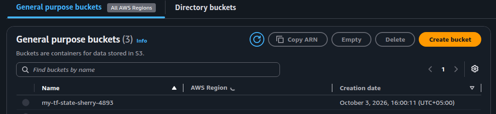
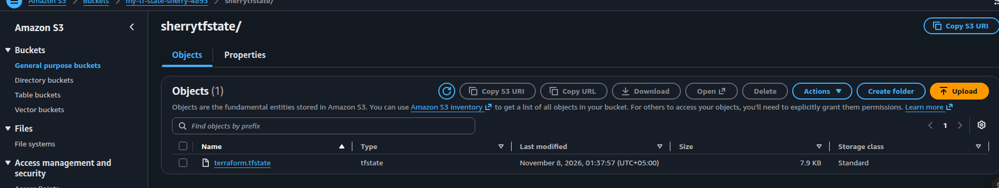
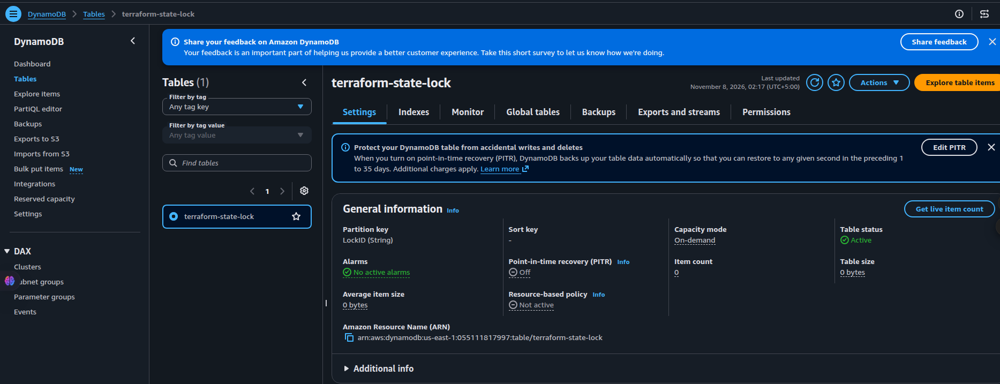
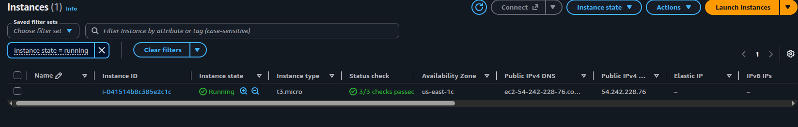

<div align="center">

# Terraform AWS Practice

**A personal sandbox for learning Terraform on AWS**

`practice` → `apply` → `screenshot` → `push` → repeat

[](https://www.terraform.io/)
[](https://aws.amazon.com/)
[](#)

</div>

---

## Why this repo exists

This is **not** production infrastructure.

It is a place to learn in public:

| Focus | What you get |
|-------|----------------|
| Hands-on AWS | Real resources, real console, real mistakes |
| Terraform fundamentals | Providers, variables, outputs, state |
| Remote state | S3 backend, migrate, locking |
| Habit | Push each practice so progress is saved |

> Clone it. Break it. Destroy it. Push what you learned.

---

## Repo map

```text
Terraform-AWS-Prac/
│
├── First-Module/           Practice 01 — EC2 + variables + outputs
│   ├── main.tf
│   ├── vaiables.tf
│   ├── output.tf
│   └── terraform.tfvars
│
├── Terraform-state/        Practice 02 — remote state (S3 + lock)
│   ├── mian.tf
│   ├── backend.tf
│   ├── pics/               Console screenshots
│   └── README.md
│
├── .gitignore
└── README.md               ← you are here
```

| Lab | Folder | Skills |
|-----|--------|--------|
| **01** | [`First-Module/`](./First-Module/) | Provider · variables · EC2 · outputs |
| **02** | [`Terraform-state/`](./Terraform-state/) | Local → S3 state · migrate · lockfile |

---

## Practice 01 — First Module

**Goal:** launch a simple EC2 instance using variables, then print an output.

| File | Role |
|------|------|
| `main.tf` | AWS provider + `aws_instance` |
| `vaiables.tf` | Inputs: `ami_value`, `instance_type_value` |
| `terraform.tfvars` | Local values for those variables |
| `output.tf` | Prints the instance public IP |

```bash
cd First-Module
terraform init
terraform plan
terraform apply
```

Details → [`First-Module/README.md`](./First-Module/README.md)

---

## Practice 02 — Terraform State

**Goal:** understand where state lives, move it to S3, and lock it safely.

### What `mian.tf` creates

| Resource | Service | Practice focus |
|----------|---------|----------------|
| `aws_instance.terraform_state` | EC2 `t3.micro` | Compute from Terraform |
| `aws_s3_bucket.s3_bucket` | S3 | Bucket that will store state |
| `aws_dynamodb_table.aws_dynamodb_table` | DynamoDB | Classic lock table (`LockID`) |

### Backend idea

```hcl
terraform {
  backend "s3" {
    bucket       = "sherry-tf-state-test"
    key          = "sherrytfstate/terraform.tfstate"
    region       = "us-east-1"
    use_lockfile = true
  }
}
```

### Bootstrap flow (the lesson)

```text
 1  Comment backend.tf     →  apply with LOCAL state
 2  Create S3 (+ DynamoDB) →  bucket exists in AWS
 3  Enable backend.tf      →  terraform init -migrate-state
 4  Done                   →  state lives in S3 + lockfile
```

```bash
cd Terraform-state
terraform init && terraform plan && terraform apply
# after enabling backend.tf
terraform init -migrate-state
terraform destroy   # when the practice session is over
```

Details → [`Terraform-state/README.md`](./Terraform-state/README.md)

---

## Screenshots — Practice 02

<table>
  <tr>
    <td align="center" width="50%">
      
      <br /><sub><b>S3</b> — buckets</sub>
    </td>
    <td align="center" width="50%">
      
      <br /><sub><b>S3</b> — remote <code>terraform.tfstate</code></sub>
    </td>
  </tr>
  <tr>
    <td align="center" width="50%">
      
      <br /><sub><b>DynamoDB</b> — <code>terraform-state-lock</code></sub>
    </td>
    <td align="center" width="50%">
      
      <br /><sub><b>EC2</b> — running instance</sub>
    </td>
  </tr>
</table>

---

## Prerequisites

- [Terraform](https://developer.hashicorp.com/terraform/install) installed
- AWS credentials configured (`aws configure` or env vars)
- IAM rights for EC2, S3, and DynamoDB in the regions you use

---

## Practice safety

| Do | Don't |
|----|--------|
| Use tiny resources (`t3.micro`) | Leave labs running overnight |
| `terraform destroy` when done | Commit `*.tfstate` or `.terraform/` |
| Rename buckets if create fails | Assume S3 names are free globally |

---

## Learning path

```text
[1] First-Module     variables · apply · outputs
        │
        ▼
[2] Terraform-state  local state → S3 migrate → lock
        │
        ▼
[3] Push notes + screenshots after each lab
        │
        ▼
[4] Add a new folder for the next topic
```

---

<div align="center">

**Push practice here.**  
Every folder is a lesson — keep going.

</div>
