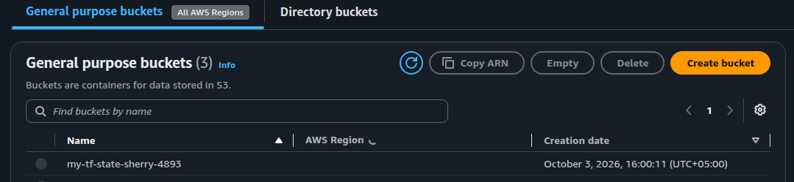
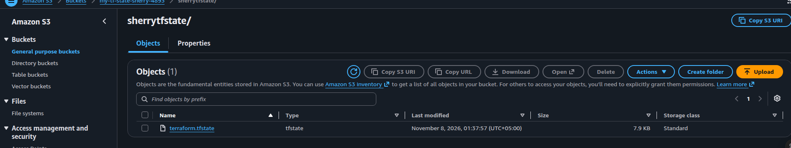
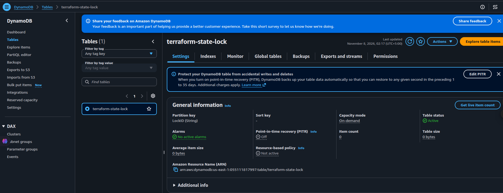
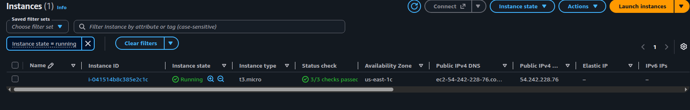
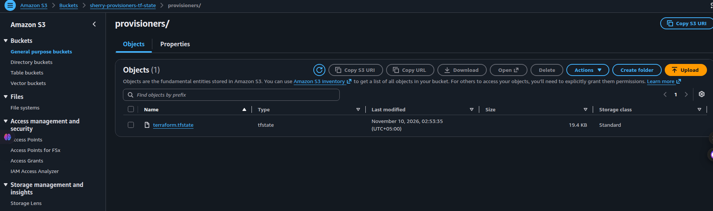
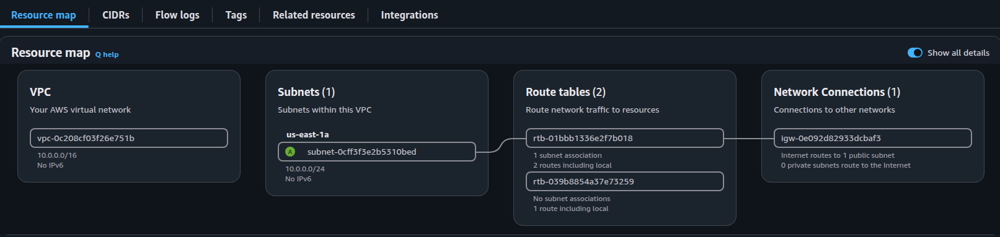
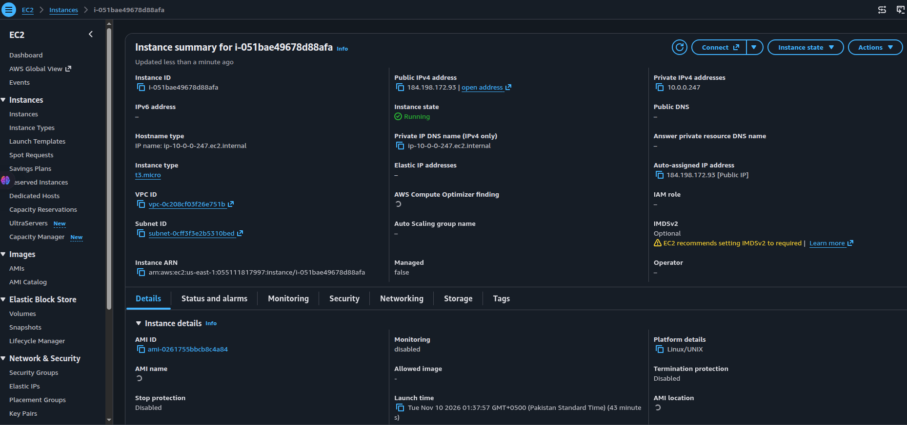
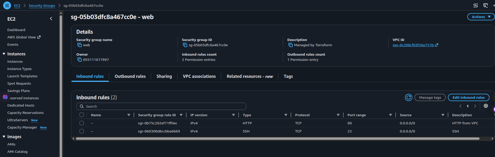
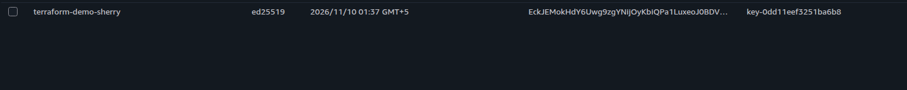
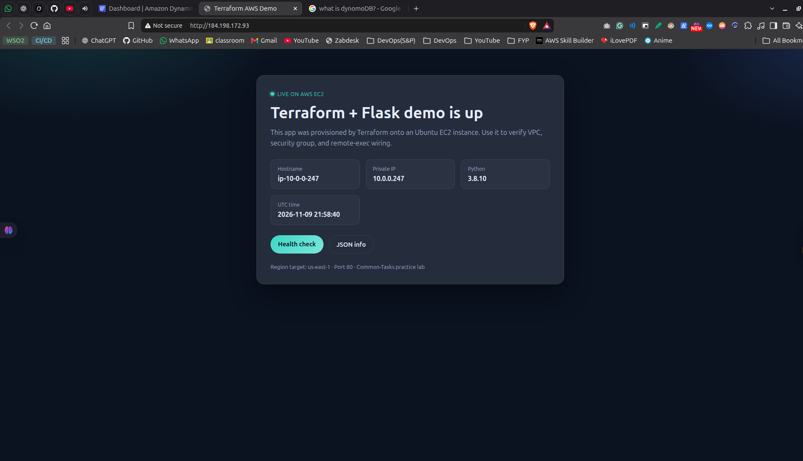

<div align="center">

# Terraform AWS Practice

**A personal sandbox for learning Terraform on AWS**

`practice` → `apply` → `screenshot` → `push` → repeat

[](https://www.terraform.io/)
[](https://aws.amazon.com/)
[](#)

</div>

---

## Why this repo exists

This is **not** production infrastructure.

It is a place to learn in public:

| Focus | What you get |
|-------|----------------|
| Hands-on AWS | Real resources, real console, real mistakes |
| Terraform fundamentals | Providers, variables, outputs, state |
| Remote state | S3 backend, migrate, locking |
| Provisioners | file + remote-exec onto EC2 |
| Workspaces | Modules · dev/stage/prod · separate state |
| Habit | Push each practice so progress is saved |

> Clone it. Break it. Destroy it. Push what you learned.

---

## Repo map

```text
Terraform-AWS-Prac/
│
├── First-Module/           Practice 01 — EC2 + variables + outputs
│   ├── main.tf
│   ├── vaiables.tf
│   ├── output.tf
│   └── terraform.tfvars
│
├── Terraform-state/        Practice 02 — remote state (S3 + lock)
│   ├── mian.tf
│   ├── backend.tf
│   ├── pics/
│   └── README.md
│
├── Provisioners/           Practice 03 — VPC + provisioners + Flask
│   ├── main.tf
│   ├── backend.tf
│   ├── app.py
│   ├── pics/
│   └── README.md
│
├── Workspaces/             Practice 04 — modules + workspaces
│   ├── main.tf
│   ├── vars.tf
│   ├── Modules/ec2/
│   └── README.md
│
├── Secrets/               Practice 05 — Vault provider + KV secrets
│   ├── main.tf
│   ├── terraform.tfstate
│   ├── terraform.tfstate.backup
│   ├── .terraform.lock.hcl
│   └── .terraform/
│
├── .gitignore
└── README.md               ← you are here
```

| Lab | Folder | Skills |
|-----|--------|--------|
| **01** | [`First-Module/`](./First-Module/) | Provider · variables · EC2 · outputs |
| **02** | [`Terraform-state/`](./Terraform-state/) | Local → S3 state · migrate · lockfile |
| **03** | [`Provisioners/`](./Provisioners/) | VPC · SG · file/remote-exec · Flask · S3 state |
| **04** | [`Workspaces/`](./Workspaces/) | Modules · workspaces · per-env sizing |
| **05** | [`Secrets/`](./Secrets/) | Vault provider · AppRole auth · KV v2 secrets · dynamic tags |
| **Note** | Secrets folder contains `terraform.tfstate` + Vault credentials — **do not commit** |

---

## Practice 01 — First Module

**Goal:** launch a simple EC2 instance using variables, then print an output.

| File | Role |
|------|------|
| `main.tf` | AWS provider + `aws_instance` |
| `vaiables.tf` | Inputs: `ami_value`, `instance_type_value` |
| `terraform.tfvars` | Local values for those variables |
| `output.tf` | Prints the instance public IP |

```bash
cd First-Module
terraform init
terraform plan
terraform apply
```

Details → [`First-Module/README.md`](./First-Module/README.md)

---

## Practice 02 — Terraform State

**Goal:** understand where state lives, move it to S3, and lock it safely.

### What `mian.tf` creates

| Resource | Service | Practice focus |
|----------|---------|----------------|
| `aws_instance.terraform_state` | EC2 `t3.micro` | Compute from Terraform |
| `aws_s3_bucket.s3_bucket` | S3 | Bucket that will store state |
| `aws_dynamodb_table.aws_dynamodb_table` | DynamoDB | Classic lock table (`LockID`) |

### Bootstrap flow

```text
 1  Comment backend.tf     →  apply with LOCAL state
 2  Create S3 (+ DynamoDB) →  bucket exists in AWS
 3  Enable backend.tf      →  terraform init -migrate-state
 4  Done                   →  state lives in S3 + lockfile
```

```bash
cd Terraform-state
terraform init && terraform plan && terraform apply
# after enabling backend.tf
terraform init -migrate-state
terraform destroy   # when the practice session is over
```

Details → [`Terraform-state/README.md`](./Terraform-state/README.md)

### Screenshots — Practice 02

<table>
  <tr>
    <td align="center" width="50%">
      
      <br /><sub><b>S3</b> — buckets</sub>
    </td>
    <td align="center" width="50%">
      
      <br /><sub><b>S3</b> — remote <code>terraform.tfstate</code></sub>
    </td>
  </tr>
  <tr>
    <td align="center" width="50%">
      
      <br /><sub><b>DynamoDB</b> — <code>terraform-state-lock</code></sub>
    </td>
    <td align="center" width="50%">
      
      <br /><sub><b>EC2</b> — running instance</sub>
    </td>
  </tr>
</table>

---

## Practice 03 — Provisioners

**Goal:** build a VPC + EC2 stack, configure it with provisioners, and host a Flask app — with remote state in S3.

### What `main.tf` creates

| Resource | Service | Practice focus |
|----------|---------|----------------|
| `aws_s3_bucket.tf_state` | S3 | Remote state bucket |
| `aws_vpc` + subnet + IGW + routes | VPC | Public network path |
| `aws_security_group.webSg` | EC2 SG | Ports **80** + **22** |
| `aws_key_pair.key_pair` | Key pair | SSH for provisioners |
| `aws_instance.server` | EC2 `t3.micro` | file + remote-exec → Flask |

Locking: **`use_lockfile`** on S3 (no DynamoDB in this lab).

```bash
cd Provisioners
# keep backend.tf commented until the bucket exists
terraform init -reconfigure
terraform plan
terraform apply
# uncomment backend.tf
terraform init -migrate-state
```

Details → [`Provisioners/README.md`](./Provisioners/README.md)

### Screenshots — Practice 03

<table>
  <tr>
    <td align="center" width="50%">
      
      <br /><sub><b>S3</b> — <code>provisioners/terraform.tfstate</code></sub>
    </td>
    <td align="center" width="50%">
      
      <br /><sub><b>VPC</b> — resource map</sub>
    </td>
  </tr>
  <tr>
    <td align="center" width="50%">
      
      <br /><sub><b>EC2</b> — running instance</sub>
    </td>
    <td align="center" width="50%">
      
      <br /><sub><b>SG</b> — HTTP 80 + SSH 22</sub>
    </td>
  </tr>
  <tr>
    <td align="center" width="50%">
      
      <br /><sub><b>Key pair</b> — <code>terraform-demo-sherry</code></sub>
    </td>
    <td align="center" width="50%">
      
      <br /><sub><b>Browser</b> — Flask app on EC2</sub>
    </td>
  </tr>
</table>

---

## Practice 04 — Workspaces

**Goal:** reuse one EC2 module across `dev` / `stage` / `prod` with separate state per environment.

### Layout

```text
Workspaces/
├── main.tf              provider + module "ec2"
├── vars.tf              ami + instance_type map (dev/stage/prod)
├── terraform.tfvars     optional value overrides
└── Modules/ec2/
    ├── main.tf          aws_instance
    └── variables.tf     module inputs (declared here, not only in root)
```

### What this lab teaches

| Concept | How it shows up |
|---------|-----------------|
| Module | `Modules/ec2` owns `aws_instance` + its own `variables.tf` |
| Root call | `module "ec2"` passes `ami` and `instance_type` |
| Workspaces | `terraform workspace new` / `select` → `dev` · `stage` · `prod` |
| Per-env size | `lookup(var.instance_type, terraform.workspace, "t3.small")` |
| Separate state | each workspace has its own state under `terraform.tfstate.d/` |

### Commands

```bash
cd Workspaces
terraform init

terraform workspace new dev      # once per env
terraform workspace new stage
terraform workspace new prod

terraform workspace select dev
terraform plan && terraform apply

# destroy only affects the CURRENT workspace — repeat per env
terraform workspace select prod && terraform destroy -auto-approve
terraform workspace select stage && terraform destroy -auto-approve
terraform workspace select dev && terraform destroy -auto-approve
```

**Note:** `terraform.tfvars` assigns values; it does not declare variables. Module inputs must be declared in `Modules/ec2/variables.tf` and passed from the root `module` block.

---

## Practice 05 — Secrets (Vault + AWS)

**Goal:** integrate Terraform with HashiCorp Vault to manage sensitive data securely — following the **Day-7 Security & Advanced Topics** lab from the Terraform Zero to Hero course.

### What `main.tf` creates

| Resource | Service | Practice focus |
|----------|---------|----------------|
| `provider "aws"` | AWS | Region `us-east-1`, EC2 `t3.micro` |
| `provider "vault"` | Vault | AppRole auth against Vault server |
| `data "vault_kv_secret_v2"` | Vault KV v2 | Read secret from KV mount |
| `aws_instance.my_instance` | EC2 | Tag injected from Vault secret |

### Vault setup (from Day-7 course)

The course covers these steps to integrate Terraform with Vault:

1. **Install Vault on EC2** — `sudo apt install vault` after adding the HashiCorp repo
2. **Start Vault in dev mode** — `vault server -dev -dev-listen-address="0.0.0.0:8200"`
3. **Enable AppRole auth** — `vault auth enable approle`
4. **Create a policy** — grant read/list access to secret paths
5. **Create an AppRole** — `vault write auth/approle/role/terraform ...` with TTLs and policies
6. **Generate Role ID + Secret ID** — retrieve with `vault read auth/approle/role/<name>/role-id` and `vault write -f auth/approle/role/<name>/secret-id`

### Authentication flow

```text
1  Vault provider authenticates via AppRole (role_id + secret_id)
2  data source reads KV v2 secret at the configured mount/path
3  secret value injected into EC2 tag dynamically
```

### Providers used

| Provider | Version | Purpose |
|----------|---------|---------|
| `hashicorp/aws` | 6.73.0 | Launch EC2 instance |
| `hashicorp/vault` | 5.13.0 | AppRole auth + KV v2 secret data source |

```bash
cd Secrets
terraform init
terraform plan
terraform apply
```

### Secrets management methods (Day-7 overview)

| Method | How it works |
|--------|--------------|
| `sensitive = true` | Marks variables/outputs so Terraform hides them from console and state |
| Secret management system | Store secrets in Vault / AWS Secrets Manager and read them at runtime |
| Remote backend (encrypted) | S3 or Terraform Cloud with encryption protects state |
| Environment variables | `TF_VAR_` or `AWS_ACCESS_KEY_ID` style env vars fed into Terraform |

---

## Prerequisites

- [Terraform](https://developer.hashicorp.com/terraform/install) installed
- AWS credentials configured (`aws configure` or env vars)
- IAM rights for EC2, VPC, S3 (and DynamoDB for Practice 02)
- SSH key at `~/.ssh/id_ed25519` for Practice 03 provisioners

---

## Practice safety

| Do | Don't |
|----|--------|
| Use tiny resources (`t3.micro`) | Leave labs running overnight |
| `terraform destroy` **per workspace** | Assume one destroy cleans all envs |
| Commit docs + screenshots | Commit `*.tfstate`, `terraform.tfstate.d/`, or `.terraform/` |
| Rename buckets if create fails | Assume S3 names are free globally |

---

## Learning path

```text
[1] First-Module      variables · apply · outputs
        │
        ▼
[2] Terraform-state   local state → S3 migrate · lock
        │
        ▼
[3] Provisioners      VPC · SG · file/remote-exec · Flask
        │
        ▼
[4] Workspaces        modules · dev/stage/prod · separate state
        │
        ▼
[5] Secrets           Vault provider · AppRole · KV v2 secrets · secure config
        │
        ▼
[6] Push notes + screenshots after each lab
```

---

<div align="center">

**Push practice here.**  
Every folder is a lesson — keep going.

</div>
