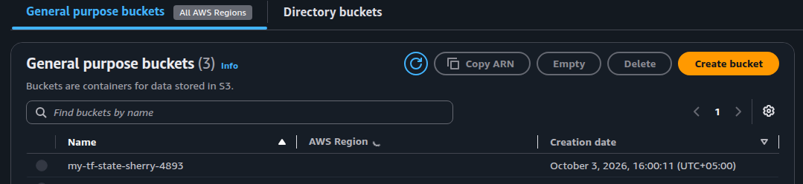
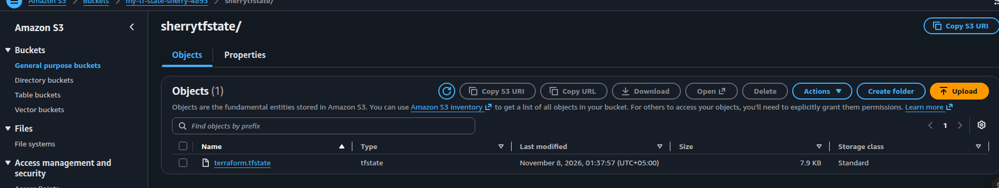
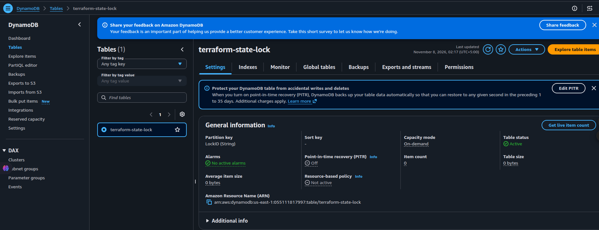
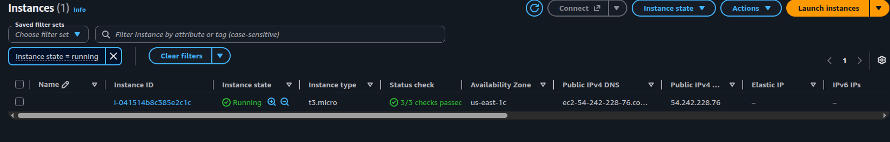

# Terraform Remote State (AWS)

Practice project that provisions AWS resources with Terraform and stores Terraform state remotely in **Amazon S3**, with state locking via **S3 lockfile** (`use_lockfile`).

## What this project creates

| Resource | Name / notes |
|----------|----------------|
| EC2 instance | `t3.micro` in `us-east-1` |
| S3 bucket | `sherry-tf-state-test` (also used as the remote state backend) |
| DynamoDB table | `terraform-state-lock` (`LockID` partition key; created for classic locking practice) |

## Project layout

```text
Terraform-state/
├── mian.tf          # Provider + AWS resources
├── backend.tf       # S3 remote backend config
├── pics/            # AWS Console screenshots
└── README.md
```

## Backend configuration

Remote state lives in S3:

- **Bucket:** `sherry-tf-state-test`
- **Key:** `sherrytfstate/terraform.tfstate`
- **Region:** `us-east-1`
- **Locking:** `use_lockfile = true` (S3-native lock file; preferred over deprecated `dynamodb_table`)

## Prerequisites

- Terraform installed
- AWS credentials configured (`aws configure` or env vars)
- Permission to manage EC2, S3, and DynamoDB in `us-east-1`

## Usage

```bash
cd Terraform-state

# First time (or after backend changes): local backend while creating the bucket/table
# Keep backend.tf commented until the S3 bucket exists, then uncomment and migrate.

terraform init
terraform plan
terraform apply

# After the S3 bucket exists and backend.tf is enabled:
terraform init -migrate-state
```

Useful commands:

```bash
terraform state list
terraform plan
terraform destroy   # tears down resources when you are done practicing
```

> **Note:** Do not commit `terraform.tfstate`, `terraform.tfstate.backup`, or `.terraform/` — they can contain sensitive data.

---

## AWS Console screenshots

### S3 — state bucket list

General purpose buckets, including the Terraform state bucket.



### S3 — remote state object

Terraform state file stored under the `sherrytfstate/` prefix.



### DynamoDB — lock table

Table `terraform-state-lock` with partition key `LockID` (on-demand capacity).



### EC2 — instance

Running `t3.micro` instance created by this configuration.


